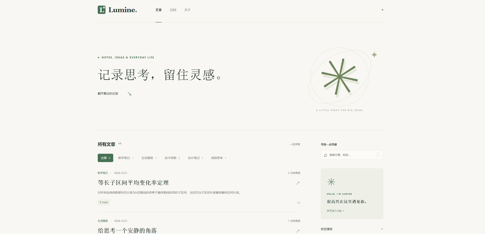

# Lumine の 博客

暖白与鼠尾草绿的响应式博客，文章放在 `posts/` 中即可，推送即发布。

## 效果
[见 1umine.github.io](https://1umine.github.io) 



## 本地运行

需要 Node.js 22 或更高版本。

```bash
npm install
npm run dev
```

打开 http://localhost:4321 。修改文章、样式或配置后自动重新构建，刷新页面查看。

```bash
npm test       # 内容解析测试
npm run build # 生成 dist/
```

## 写文章

在 `posts/` 中创建 `.md` 文件，支持子目录。示例文章可以直接修改或删除。

````markdown
---
title: 我的第一篇文章
date: 2026-10-21
category: 技术探索
tags: [JavaScript, 学习]
description: 一句话摘要，可省略，省略时从正文提取。
draft: false
---

## 第一个章节

这里开始正文，支持 **粗体**、*斜体*、列表、引用、表格、链接和图片。

### 子章节

```javascript
console.log('Hello, world!');
```
````

- `title`：省略时使用正文一级标题或文件名。正文开头的一级标题会自动省去，避免重复显示。
- `date`：建议填写 `YYYY-MM-DD`，按日期倒序排列。省略时使用 `1970-01-01`。
- `category`：一个分类，默认「随笔」。
- `tags`：标签数组，也接受英文逗号分隔的字符串。
- `draft: true`：构建时不发布该文章。
- 标题自动生成唯一锚点和章节目录，支持中文、重复标题。
- 原始 HTML 会作为文字显示，避免意外执行脚本。

图片可以与文章放在同一目录，如 `posts/images/photo.jpg`，在 `posts/hello.md` 中使用 ``。非 Markdown 文件会自动复制到对应输出目录。文章间链接请使用生成后的 `.html` 路径，例如 `[另一篇](another.html)`。

分类、标签和搜索条件可通过 URL 分享，例如 `/?category=技术探索`、`/?tag=Markdown`、`/?q=写作`。搜索范围为标题、摘要、分类和标签；支持组合筛选，按 `/` 聚焦搜索框。

## 数学公式

支持 KaTeX / LaTeX 公式，在构建时生成 HTML 和辅助阅读的 MathML。

行内公式写成 `$E = mc^2$`。独立公式使用：

```latex
$$
f(x) = \frac{1}{\sigma\sqrt{2\pi}}
\exp\left(-\frac{(x-\mu)^2}{2\sigma^2}\right)
$$
```

支持求和、积分、矩阵、`aligned` 多行对齐和 `cases` 分段函数。完整示例见 `posts/math-notes.md`。可用命令以 [KaTeX 支持列表](https://katex.org/docs/supported) 为准。

普通美元符号写成 `\$`；代码块与行内代码中的公式保持原样。长公式可以横向滚动。

## 修改站点

`site.config.json` 配置站名、描述、作者与部署路径。`basePath` 默认为空；部署到仓库子路径时填写 `/仓库名`。`url` 预留给站点扩展使用。

- `public/style.css`：颜色、字体、布局与 Markdown 样式。
- `public/app.js`：搜索、筛选、目录高亮与代码复制。
- `templates/`：页面 HTML 模板，文件用途和变量语法见 [模板说明](templates/README.md)。
- `templates/partials/`：文章卡片、侧栏、标签、目录等公共组件。
- `scripts/pages.mjs`：准备模板数据、组装页面。
- `scripts/build.mjs`：读取文章、复制资源、输出静态文件。
- `public/`：直接复制到输出目录的静态资源。

本地使用系统字体。手机上目录显示在正文前，桌面端目录固定在侧边。

修改页面内容时可直接编辑 `templates/` 中对应的 HTML。运行 `npm run dev` 时，保存模板会自动重新构建，刷新浏览器即可查看。

## GitHub Pages

仓库包含 `.github/workflows/deploy.yml`。在 GitHub 仓库的 **Settings → Pages → Build and deployment → Source** 中选择 **GitHub Actions**，推送到 `main` 或 `master` 后自动测试、构建并部署。也可以在 Actions 页面手动运行。

如果主分支名称不同，修改工作流中的 `branches`。本地 `dist/` 已忽略，不需要提交生成文件。

其他静态托管服务：构建命令填写 `npm ci && npm run build`，发布目录填写 `dist`。
